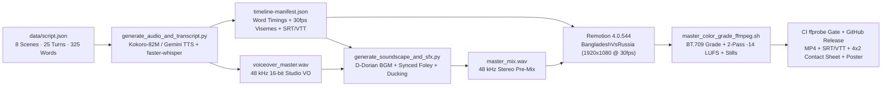

# Bangladesh vs. Russia: Population Comparison by Size

A cinema-grade, 2-minute (`1920x1080` @ `30 fps`) animated data documentary comparing the extreme geographic and demographic inversion between **Russia** (`17,098,246 km²` · `~144M` people) and **Bangladesh** (`148,460 km²` · `~175M` people).

Engineered for **100% zero-local-load cloud production**: local tooling is strictly limited to lightweight Python 3 stdlib static verification (`< 15 MB` RAM), while neural multi-voice synthesis, word-level forced alignment, procedural foley/underscore DSP, headless Chromium Remotion rendering, BT.709 color mastering, `ffprobe` QA gating, and GitHub Release publishing run end-to-end on GitHub Actions (`ubuntu-latest`).

---

## 1. System Architecture



### Canvas Safe-Zone Architecture (`1920x1080`)

| Vertical Zone | Pixel Bounds | Dedicated Layer |
| :--- | :--- | :--- |
| **Top Broadcast Bar** | `y = 0..76px` | `ChapterHUD` — chapter pill (`01 / 08`), title/subtitle, area telemetry badge, live `MM:SS:FF` timecode, and segmented 8-chapter progress bar |
| **Primary Visual Stage** | `y = 86..810px`, `x = 64..1856px` | `Scene01`–`Scene08` — D3 spherical/equal-area cartography, `1 km²` spatial simulators, hydrological diagrams, and data scoreboards |
| **Lower-Third Stage** | `y = 820..1080px` | `CharacterStage` (left/right rigged speaker booths; 2+2 ensemble pods in Scene 8) + `SyncedTranscriptBar` (`x = 308..1612px` word-highlighted captions) |

All Remotion animations are **100% frame-deterministic**: zero `Math.random()` or `Date.now()` calls exist in `src/`. Micro-motion, particle fields, and eye-blink intervals are driven exclusively by `useCurrentFrame()`, `spring()`, clamped `interpolate()`, Halton sequences, and a 32-bit `mulberry32` hash (`seededUnit`).

---

## 2. The 4 Rigged Studio Characters

Each speaker is an articulated multi-layer 2D SVG rig (`src/components/CharacterRig.tsx` & `src/components/CharacterStage.tsx`) featuring a **6-viseme oral cavity/teeth/tongue interpolator** driven by 30 fps RMS audio envelopes (`manifest.visemes`), deterministic blinking every `110–144` frames, **7 facial emotion poses** (`neutral`, `curious`, `shocked`, `analytical`, `proud`, `warm`, `amused`), and **4 spring-driven foreground arm gestures** (`point_up`, `open_palms`, `chin_think`, `count_fingers`).

| ID | Speaker | Role & Studio Desk | Signature Palette | Kokoro-82M Voice | Gemini Native Voice |
| :--- | :--- | :--- | :--- | :--- | :--- |
| `noah` | **Noah Vance** | Documentary Host (`GLOBAL DESK`) | Imperial Amber `#F59E0B` | `am_michael` (`en-us`) | `Charon` |
| `rafiq` | **Dr. Rafiq Rahman** | Delta Demographer (`DHAKA · BANGLADESH`) | Bengal Emerald `#10B981` / Crimson `#F42A41` | `bm_fable` (`en-gb`) | `Puck` |
| `dmitri` | **Prof. Dmitri Volkov** | Arctic Cartographer (`MOSCOW · RUSSIA`) | Arctic Cyan `#38BDF8` | `am_fenrir` (`en-us`) | `Orus` |
| `maya` | **Maya Lin** | Lead Data Visualizer (`SPATIAL LAB`) | Coral Rose `#FB7185` | `af_heart` (`en-us`) | `Aoede` |

---

## 3. The 8 Documentary Chapters

Every statistic is cross-verified against UN DESA WPP 2024, World Bank/FAO land-area tables, BBS Census 2022, Rosstat, and IPA permafrost surveys (documented in `docs/DEMOGRAPHIC_FACTS.md`).

| # | Component | Chapter Title | Visual & Cartographic Engine | Key Verified Metrics |
| :---: | :--- | :--- | :--- | :--- |
| **01** | `Scene01ColdOpenShock` | **The Scale Paradox** | 3D orthographic `d3-geo` globe slewing from Siberia across 11 time zones down to the Bay of Bengal | `17,098,246 km²` (`144M`) vs `148,460 km²` (`175M`, `+31M` more people) |
| **02** | `Scene02TrueSizeOverlay` | **True Size Overlay** | Mercator ghost dissolve into Lambert Azimuthal Equal-Area projection tiling 115 true-scale copies of Bangladesh inside Russia | `115.2×` area fit · `9,000 km` (`11h` flight) vs `600 km` span |
| **03** | `Scene03YakutiaVsBangladesh` | **Yakutia vs. Bangladesh** | Equal-area Sakha Republic vs. Bengal plains + Greater Dhaka vs. Siberia comparison bars | Sakha `3.08M km²` (`20.8×` BD, `-50°C`, `1M`) · Dhaka `24M` vs Siberia `36M` |
| **04** | `Scene04OneSqKmSimulator` | **Inside One Square Kilometer** | Side-by-side `1 km × 1 km` (`100m` grid) human beacon simulator with diagonal Bengal river channel | `8.4 / km²` (Russia) vs `1,330 / km²` (Bangladesh dry land, `158×` denser) |
| **05** | `Scene05DeltaMiracle` | **The Himalayan Delta Engine** | Animated Padma–Jamuna–Meghna silt transport, 3-crop rice wheel (*Aus*, *Aman*, *Boro*), and 1950–present growth curve | `1B+ tons/yr` Himalayan silt · `3` annual harvests · `40M (1950) → 175M` |
| **06** | `Scene06FrozenGiantUralDivide` | **The Ural & Permafrost Divide** | Equal-area Russia split along `60°E` Ural ridge with `65%` permafrost isotherm mask, European heartland glow, and Trans-Siberian corridor | `65%` permafrost · European Russia holds `75%+` citizens on `23%` of land |
| **07** | `Scene07DensitySwapExperiment` | **If Densities Swapped** | Counterfactual density-swap simulation scaling against global population benchmarks | Russia @ BD density = `20.1B+` (`2.5×` Earth) · BD @ RU density = `1.25M` |
| **08** | `Scene08FinaleSynthesis` | **Land vs. Life** | 4-speaker ensemble roundtable, 6-metric comparative scoreboard, and editorial end-title lockup | Synthesis of territorial scale vs. riverine & climatic carrying capacity |

---

## 4. Cinema Color-Grading & Broadcast Audio Pipeline

### Two-Stage Visual Grade
1. **In-Composition Optical Grade (`src/components/CinemaGradeOverlay.tsx`)**:
   - Cartographic obsidian base (`#050911`) with subtle Arctic cyan (`#38BDF8`), Bengal emerald (`#10B981`), and imperial amber (`#F59E0B`) split-tone ambient wash.
   - Anamorphic radial vignette, `12 fps`-stepped `feTurbulence` monochrome 35mm film grain, `1px` gate hairline, and 14-frame cylindrical lens halation flares (`SceneCutFlash`) across internal chapter cuts.
2. **Post-Render FFmpeg Mastering Pass (`scripts/master_color_grade_ffmpeg.sh`)**:
   - Master S-curve tonal contrast: `curves=m='0/0 0.18/0.15 0.50/0.51 0.80/0.84 1/1'`
   - Cool-shadow / warm-highlight split-toning: `colorbalance=rs=-0.02:gs=0.005:bs=0.025:rh=0.02:gh=0.01:bh=-0.015`
   - Micro-saturation & luma sharpening: `eq=saturation=1.06:contrast=1.03,unsharp=5:5:0.30:5:5:0.0`
   - Explicit Rec.709 mastering tags (`-colorspace bt709 -color_primaries bt709 -color_trc bt709`), H.264 High@L4.2 (`-crf 16 -preset slow -pix_fmt yuv420p -movflags +faststart`), and soft-muxed `mov_text` English subtitles.

### Studio Soundscape & EBU R128 (`-14 LUFS`) Audio Mastering
1. **Voiceover Synthesis & Alignment (`scripts/generate_audio_and_transcript.py`)**:
   - Synthesizes each turn at `48 kHz`, trims dead air below `-45 dBFS` with `40 ms` half-Hann breath fades, peak-normalizes speakers to `-3.0 dBFS`, and runs `faster-whisper` (`base.en`, `int8`) forced DP cross-alignment so captions preserve exact script typography (`17.1M`, `km²`, `-50°C`).
2. **Procedural Underscore, Foley & Ducking (`scripts/generate_soundscape_and_sfx.py`)**:
   - Generates a warm D-minor / D-Dorian detuned synth pad (`< 900 Hz` low-passed to keep the `1–4 kHz` vocal intelligibility band clear) layered with a `100 BPM` felt-marimba ostinato.
   - Places frame-exact foley cues: cold-open `55 Hz → 36 Hz` sub-drop, stereo scene-cut whoosh + felt tom (`-16 dBFS`), and crystal telemetry pings (`-22 dBFS`) on stat callouts.
   - Applies a lookahead ballistic sidechain ducker (`attack=30ms`, `release=350ms`) ducking BGM from `-15 dBFS` to `-24 dBFS` during speech, followed by a `-1.0 dBFS` stereo-linked soft-knee limiter and TPDF dither.
3. **Two-Pass Linear Loudness Normalization (`scripts/master_color_grade_ffmpeg.sh`)**:
   - Measures integrated program loudness (`loudnorm=I=-14:TP=-1.5:LRA=11:print_format=json`) in Pass 1 and applies linear EBU R128 normalization in Pass 2 (`AAC 256 kbps`, `48 kHz` stereo).

---

## 5. Cloud Render Workflow & Static QA

### Local Pre-Flight Audit (Zero Dependencies, `< 15 MB` RAM)
Never run `npm install`, `remotion`, `ffmpeg`, `kokoro`, or `whisper` on low-memory local hosts. Instead, run the pure Python 3 stdlib static validator:

```bash
python3 scripts/validate_project_static.py
```

This verifies JSON schemas, 8-scene script rules and word-count bounds (`250–400` words), all relative TypeScript/TSX imports and named/default exports across `src/`, external package declarations against `package.json`, zero `Math.random()` / `Date.now()` calls, `py_compile` on Python scripts, and `bash -n` on `scripts/master_color_grade_ffmpeg.sh`.

### GitHub Actions Cloud Render (`.github/workflows/render-video.yml`)
Triggered automatically on every push to `main` or manually via `workflow_dispatch`:

```bash
# Default render using cached Kokoro-82M v1.0 neural multi-voice TTS
gh workflow run render-video.yml -f tts_engine=kokoro

# Optional render using Google Gemini 2.5 Native TTS (requires GEMINI_API_KEY repo secret; auto-falls back to Kokoro)
gh workflow run render-video.yml -f tts_engine=gemini
```

Each workflow run:
1. Synthesizes voiceover stems, aligns word timestamps via `faster-whisper`, and writes `src/generated/timeline-manifest.json`, `transcript.srt`, and `transcript.vtt`.
2. Synthesizes the procedural BGM bed, frame-accurate foley bus, and sidechain-ducked `master_mix.wav`.
3. Runs `npx tsc --noEmit`, renders `out/raw_remotion.mp4` (`--crf=16 --gl=angle`), and executes `scripts/master_color_grade_ffmpeg.sh`.
4. Runs automated `ffprobe` + `volumedetect` assertions (`1920x1080`, `h264` + `aac`, non-zero audio volume, `95–165s` duration) and publishes a full report to `$GITHUB_STEP_SUMMARY`.
5. Uploads the `bd-vs-russia-video-bundle` workflow artifact and publishes a tagged GitHub Release (`render-v1.<run_number>`) containing:
   - `out/bd-vs-russia-population-1080p-mastered.mp4`
   - `public/captions/transcript.srt` & `public/captions/transcript.vtt`
   - `out/contact-sheet-8scenes.jpg`
   - `out/poster-thumbnail.png`

---

## 6. Repository Structure

```text
.
├── .github/workflows/
│   └── render-video.yml                  # End-to-end cloud synthesis, Remotion render, QA & Release CI
├── data/
│   └── script.json                       # 8-chapter, 4-speaker documentary script (325 words)
├── docs/
│   ├── DEMOGRAPHIC_FACTS.md              # Primary sources & mathematical derivations for all metrics
│   └── plans/MASTER_PLAN.md              # Production specification & module architecture
├── scripts/
│   ├── generate_audio_and_transcript.py  # Kokoro-82M / Gemini TTS + faster-whisper + 30fps visemes
│   ├── generate_soundscape_and_sfx.py    # D-Dorian BGM, frame-synced foley & sidechain master mix
│   ├── master_color_grade_ffmpeg.sh      # BT.709 cinema grade, 2-pass -14 LUFS, contact sheet & poster
│   └── validate_project_static.py        # Pure Python 3 stdlib static QA & module-graph validator
└── src/
    ├── index.ts                          # Remotion entry point
    ├── Root.tsx                          # Composition registration + dynamic calculateMetadata
    ├── MainVideo.tsx                     # Master 8-scene sequencer, backdrop & optical overlays
    ├── generated/timeline-manifest.json  # Frame-accurate scene, turn, word & viseme timeline
    ├── components/                       # ChapterHUD, CharacterRig, CharacterStage, GeoMapEngine, etc.
    ├── scenes/                           # Scene01ColdOpenShock.tsx .. Scene08FinaleSynthesis.tsx
    ├── theme/                            # Design tokens, seededUnit PRNG & Google Fonts loader
    └── types/                            # Strict TypeScript interfaces & TopoJSON declarations
```
